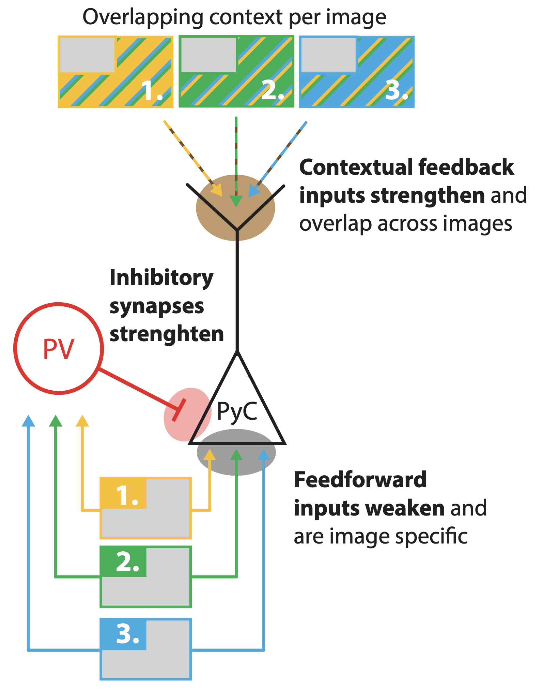
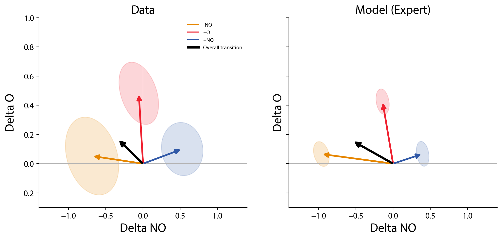

# context-contrasting-model

[](https://doi.org/10.1101/2024.06.10.598181)

Computational model code accompanying [Seignette et al. (2026)](https://doi.org/10.1101/2024.06.10.598181).

## Summary
<table>
<tr>
<td width="55%" valign="top">

Pyramidal cells (PyCs) in visual cortex change their responses with experience, but not all in the same way: after familiarization, some cells respond *less* to the images they see (-NO), some respond *more* (+NO), and some begin to respond even when the image is occluded and only its context is present (+O). 

The computational model in this repository shows that all three transitions can emerge from one small canonical circuit: a two-compartment PyC that combines feedforward input at the soma with contextual feedback at its apical dendrite, and a PV interneuron that divisively inhibits it.

We propose three opposing plasticity rules acting together during familiarization: 
- feedforward synapses depress with repeated activity, 
- apical feedback synapses strengthen with repeated presentation of overlapping contextual inputs, 
- and feedforward/lateral inhibition strengthens with correlated PV and PyC activity. 

Which transition a cell undergoes depends on its starting synaptic balance, and the same rules reproduce the diverse set of empirically-observed transitions for both familiar and novel images.

</td>
<td width="45%" valign="middle">



</td>
</tr>
</table>



*Change in occluded (O) vs. non-occluded (NO) response after familiarization: empirical cells (left) and the three familiar-image model transitions (right).*

Model code for six mean-field models of PyC/PV transitions: familiar and novel, each with +NO, +O and -NO transitions. Every model is one YAML file in `configs/`; trial timing, counts and contextual breadth are in `configs/protocol.yaml`.

## Setup

```bash
uv sync
```

## Layout

| Path | Purpose |
|---|---|
| `configs/` | One parameter set per model, plus `protocol.yaml` |
| `src/model.py` | One PyC/PV pair: dynamics and three plastic synapses |
| `src/simulate.py` | Naive probes, familiar training, expert probes, acute silencing |
| `src/robustness.py` | One-at-a-time parameter and initial-weight sweeps |
| `plotting/` | `plot.py` and `final_results.ipynb` for the final panels |

## Run

From the repository root:

```bash
uv run python -m src.simulate      # results/model.csv, results/model_trial_responses.csv
uv run python -m src.robustness    # results/model_robustness.csv, figures/robustness/
uv run jupyter notebook plotting/final_results.ipynb   # figures/final_layout/
```

Simulation defaults to 50 test trials and seeds 0–9 for every config (`--test-trials`, `--seeds`, `--jobs`). Each config/seed pair runs as its own process, and results do not depend on the worker count.

## Outputs

- `results/ground_truth.csv`: empirical sector membership, per-neuron traces and transition vectors (fixed input, exported from the thesis data analysis).
- `results/model.csv`: trial-averaged traces and transition vectors per config and seed (naive, expert, FB/PV/combined silencing).
- `results/model_trial_responses.csv`: per-trial NO/O responses.
- `results/model_robustness.csv`: one row per sweep point (figures go to `figures/robustness/`).
